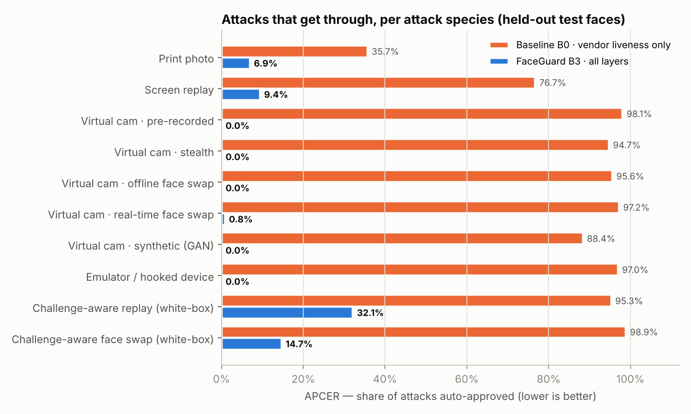
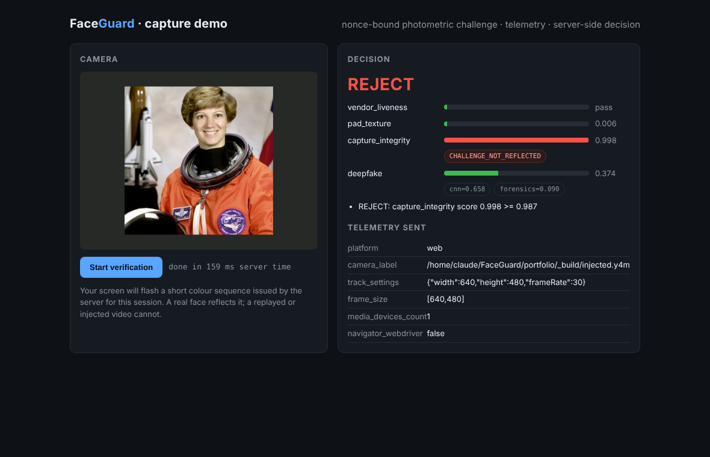
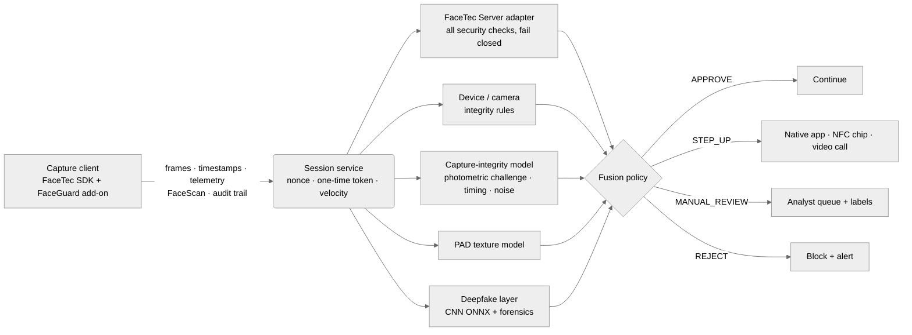
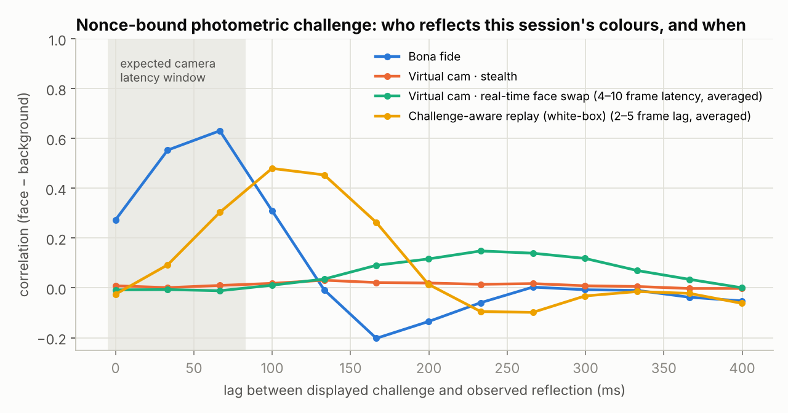

# FaceGuard: deepfake, injection & spoof defence for FaceTec-based face verification


FaceGuard is a **defence-in-depth layer around a FaceTec 3D-liveness flow**. It hardens remote
identity verification against the attacks that liveness certification does not cover: **virtual-camera
and emulator injection, real-time and offline face swaps, synthetic faces, API replay and threshold
probing**. It also adds an independent second opinion on print and screen replay.

It is built on my [ML Model Serving Platform](#built-on-the-ml-model-serving-platform): every detector is
a versioned model in a registry, promoted and rolled back through an API and monitored with Prometheus.

> **Portfolio project, stated honestly.** No FaceTec licence is used. The FaceTec integration is a
> server-side adapter written against FaceTec's public API shape, and a simulated vendor stands in
> for it in tests. Attacks are **software-simulated** on real public face photos, and every
> limitation is listed in [the test report](docs/02-adversarial-test-report.md#7-limitations-and-threats-to-validity).

---

## Results at a glance (held-out test split, 3610 attack sessions · 1083 bona fide)

| | Vendor liveness only (B0) | **FaceGuard (B3)** |
|---|---|---|
| Mean attack pass rate (APCER, 10 species) | 87.8% | **6.4%** |
| Worst species | 98.9% | **32.1%** |
| Honest users rejected (BPCER) | 1.75% | **2.40%** |
| Honest users stepped-up / reviewed | 0.0% / 0.0% | 4.0% / 0.5% |
| Integration attacks blocked (replay, forged token, client-verdict tampering, probing, device farms) | – | **11/11** (automated tests) |



### Live: a pre-recorded video injected into the browser's camera, automation flag hidden

Device and telemetry checks see a normal webcam. The nonce challenge does not reflect, so the session
is rejected (`CHALLENGE_NOT_REFLECTED`). Reproduce with `scripts/demo_injection.py`.



---

## The brief → where it is delivered

| Job requirement | Delivered in |
|---|---|
| Review the FaceTec liveness flow and map its weak points | [**Deliverable 1: Vulnerability assessment**](docs/01-vulnerability-assessment.md): 19 attack vectors with likelihood × impact, data-flow trust boundaries, prioritised roadmap |
| Assess FaceTec's real risks vs deepfakes and injection | [Deliverable 1 §4](docs/01-vulnerability-assessment.md#4-known-risks-of-facetec-and-similar-liveness-sdks-against-deepfakes): certification gap (ISO/IEC 30107-3 vs CEN/TS 18099), web vs native, liveness ≠ identity |
| Design + implement AI layers: injection detection, frame/texture artefacts, device and camera integrity | `src/liveness/`: [**Deliverable 3: Mitigation layer**](docs/03-mitigation-layer.md) |
| Adversarial tests: deepfake, face-swap and replay attempts with pass/fail rates | `src/attacks/`, `src/evaluation/`: [**Deliverable 2: Test report**](docs/02-adversarial-test-report.md) |
| Measured improvement (APCER/BPCER) | Deliverables 2 & 3, rendered from `reports/results.json` |
| Thresholds, monitoring, fallback, manual-review rules | [**Deliverable 4: Recommendations**](docs/04-recommendations.md), `configs/policy.yaml`, `monitoring/` |

---

## How it works



**1. Nonce-bound photometric challenge (anti-injection).** The server derives a random colour
sequence per session, and the client flashes it on screen during capture. A real face reflects
*this* sequence at camera latency, and more than its background does. A pre-recorded or
offline-generated stream cannot contain it. A print or screen reflects it uniformly. A real-time face
swap reflects it **4–10 frames late**. Security comes from the nonce, not from a learned model.



**2. Device and camera integrity.** Virtual-camera drivers, browser automation, emulators, hooking
frameworks and failed Play Integrity / App Attest are hard rejects. Benign virtual cameras, missing
attestation and resolution mismatches trigger a step-up.

**3. Deepfake layer trained without deepfakes.** A compact CNN (PyTorch → ONNX) and a forensics model
(face vs surroundings noise, sharpness, seam, up-sampling peaks) are trained only on bona fide faces
and *injection-faithful* Self-Blended Images. Face-swap species they never saw are detected.

**4. Calibrated fusion.** Each layer has review and reject thresholds set from bona fide quantiles
on validation data. The most severe outcome wins. Reviewers see reason codes, not just a score.

**5. Integration hardening.** The verdict comes only from the server-to-server FaceTec response,
every security check is required, tokens are one-time with atomic consumption, and there are
velocity and device-farm limits. Each of these is an automated test.

---

## Built on the ML Model Serving Platform

This repository started as my **ML Model Serving Platform (MSP)**: registry (PostgreSQL), artifact
storage, loader + in-memory cache, transactional promotion/rollback, Prometheus/Grafana and
structured logs. The original MSP test suite still runs unchanged.

| MSP capability | How FaceGuard uses it | Extension made here |
|---|---|---|
| Model registry + versions | 4 detectors: `faceguard-pad-texture`, `-capture-integrity`, `-deepfake`, `-deepfake-forensics` | – |
| Loader | sklearn/joblib | **Loader registry**: `onnx/onnx`, `pytorch/onnx` via ONNX Runtime (`OnnxModel` wrapper) |
| Promotion / rollback | Promoting a detector switches the live pipeline on the next request (tested) | `ModelRuntime.get_production_model()` |
| Cache + metrics | Hot detectors stay in RAM, cache hits and loads per detector | FaceGuard metrics + alert rules + dashboard |
| PostgreSQL only | – | `DATABASE_URL` → SQLite for local runs and CI (partial unique indexes declared for both dialects) |

---

## Quick start

```bash
#linux/Mac
python3.12 -m venv .venv
source .venv/bin/activate
#windows
py -3.12 -m venv .venv
.venv\Scripts\Activate.ps1

which python #/FaceGuard/.venv/bin/python
python -m pip install --upgrade pip
pip install -r requirements-train.txt
python -m pytest -q

#just api in doker
docker compose up -d db
python -m src.training.register --version 1.0.0 --in-process
uvicorn src.serving.app:app --reload --port 8000

#all in docker
docker compose up --build -d
docker compose exec api python -m src.training.register --version 1.0.0

---
make assets data sessions train eval report   # full pipeline on CPU (~1.5 h on 2 cores)
make test                                     # MSP + FaceGuard suites: 119/119 passing (SQLite, no Docker)
make run                                      # registers detectors, API on :8000, capture demo at /demo
# or the full stack with PostgreSQL, Prometheus (alerts) and Grafana (dashboards):
cp env.example .env && make up && docker compose exec api python -m src.training.register --version 1.0.0
```

```bash
# 1) open a session: nonce challenge + one-time token
curl -s -X POST localhost:8000/v1/liveness/sessions -H 'content-type: application/json' \
     -d '{"user_ref":"applicant-42","device_id":"9f3c…"}'
# 2) submit frames + telemetry + FaceTec payload -> decision with per-layer reasons
curl -s -X POST localhost:8000/v1/liveness/sessions/$SID/verify -H 'content-type: application/json' -d @capture.json
```

| Endpoint | Purpose |
|---|---|
| `POST /v1/liveness/sessions` | Issue nonce colour challenge, one-time HMAC token, vendor session token (velocity-limited) |
| `POST /v1/liveness/sessions/{id}/verify` | Analyse capture → `APPROVE` / `STEP_UP` / `MANUAL_REVIEW` / `REJECT` + layers, reasons, model versions |
| `GET /v1/liveness/reviews` · `POST /v1/liveness/reviews/{id}` | Manual-review queue and analyst outcome (labels for retraining) |
| `GET /v1/liveness/policy` | Active calibrated thresholds |
| `/models/...` | MSP registry, load, predict, promote (unchanged) |
| `/metrics` · `/health` · `/demo` | Prometheus, liveness probe, browser capture demo |

---

## Project structure

```text
src/
  serving/        MSP core: registry, storage, loader registry (+ONNX), cache, lifecycle, observability
  liveness/       FaceGuard: sessions, challenge, vendor adapters (FaceTec, simulated), signals, fusion, API
    signals/      capture_integrity · texture (PAD) · deepfake (CNN) · artifacts (forensics) · matching (SFace)
  attacks/        red-team instruments: print, replay, virtual camera, emulator, face swap, SBI, GAN, white-box
  training/       data prep, deepfake CNN (PyTorch → ONNX), forensics + tabular models, registry publish
  evaluation/     harness (seeded campaigns), metrics (APCER/BPCER/IAPMR/DET), calibration, report
configs/          policy.yaml (calibrated thresholds)
docs/             01 vulnerability assessment · 02 test report · 03 mitigation layer · 04 recommendations
monitoring/       Prometheus scrape + alert rules, Grafana dashboards (MSP + FaceGuard)
web/              reference capture client (challenge, timestamps, telemetry)
tests/            MSP suites + FaceGuard: loader, signals, fusion, FaceTec adapter, API logic attacks
```

## Data & licences

Faces: public photos from two MIT-licensed GitHub repositories (downloaded by `scripts/download_assets.sh`,
never committed). Face detection: YuNet (MIT). Face recognition: SFace (Apache-2.0), both OpenCV Zoo.
Test face: NASA astronaut photo (`skimage.data.astronaut`, public domain). No face images are published
in this repository or its reports.

## Author

**Nirvana Fanaelahi**: ML / MLOps engineer. Third project in a portfolio arc:
fraud-detection model → ML Model Serving Platform → **FaceGuard (security ML on that platform)**.
