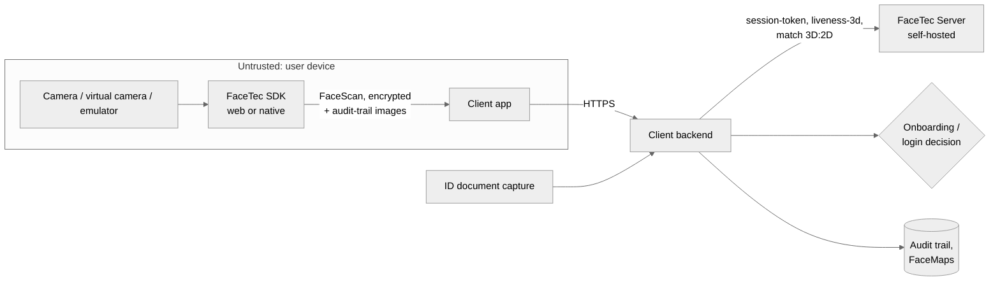

# Deliverable 1 — Vulnerability Assessment
## FaceTec-based face verification flow vs. deepfakes, injection and presentation attacks

| | |
|---|---|
| **Scope** | Remote identity verification flow built on FaceTec 3D liveness (web + native mobile), from camera to the onboarding / login decision |
| **System assessed** | *Reference* FaceTec integration (typical architecture described in §2). In a client engagement, §2 is replaced by the client's actual flow after code, config and log review (checklist in §7). |
| **Method** | Threat modelling (STRIDE on the data flow), attack-tree enumeration, rating per §1.3, validation of the attack classes that can be simulated in the FaceGuard harness ([Deliverable 2](02-adversarial-test-report.md)) |
| **Standards vocabulary** | ISO/IEC 30107-1/-3 (presentation attack detection, APCER/BPCER), CEN/TS 18099:2024 (biometric data injection attack detection: injection attack *instrument* vs *method*), ISO/IEC 25456 (injection attack detection, in development) |

> **Honesty note.** FaceTec is a proprietary SDK and no FaceTec licence was used for this portfolio
> project. This assessment draws on FaceTec's public documentation, how FaceTec flows are usually
> integrated, and the generic deepfake/injection threat class. It does not report any FaceTec
> zero-day. To the author's knowledge, at the time of writing there is no public, independently
> verified bypass of *current* FaceTec 3D liveness. The highest risks below are **integration gaps
> and attack classes outside ISO/IEC 30107-3 PAD certification**, not a flaw in FaceTec's matcher.

---

## 1. Threat model

### 1.1 Attacker goals

| Goal | Typical attacker | What they need to beat |
|---|---|---|
| **G1 Account takeover:** pass re-authentication as the victim | Fraud ring holding the victim's photos or videos (social media, leaks, earlier KYC selfies) | Liveness + 1:1 match against the victim's enrolment |
| **G2 New-account fraud:** onboard with a stolen or synthetic identity | Fraud ring, money-mule recruiter | Liveness + 1:N/1:1 match against an ID document photo they control |
| **G3 Account farming:** many accounts, few real people | Bonus-abuse or bot operator | Liveness at scale; velocity and device-reuse controls |
| **G4 Probing:** learn where thresholds sit | Any of the above | Unlimited retries; verbose error messages |

### 1.2 Data flow and trust boundaries (reference integration)



*Trust boundary 1* is the device: everything it sends, including camera frames, device metadata and
"success" callbacks, is attacker-controlled. *Trust boundary 2* is the backend ↔ FaceTec Server link.
It is trusted, but only if the backend actually makes the call and reads the response correctly.

### 1.3 Rating method

* **Likelihood (1–5)** combines attack potential (ISO/IEC 18045-style: elapsed time, expertise,
  knowledge of the target, equipment) with tool availability. Commodity, tutorial-level tooling
  (OBS Virtual Camera, open-source real-time face-swap, Android camera-hook modules) raises likelihood.
* **Impact (1–5)** is the business effect of one success (ATO = 5, new-account fraud = 4, farming = 3).
* **Risk = L × I**: Critical ≥ 16 · High 10–15 · Medium 5–9 · Low ≤ 4.

---

## 2. Reference flow (what is being assessed)

1. The backend gets a **session token** from FaceTec Server and passes it to the client.
2. The FaceTec SDK runs the 3D liveness UX (the user moves closer to and further from the camera)
   and produces an **encrypted FaceScan** plus **audit-trail images**.
3. The client posts FaceScan + audit trail to the backend. The backend calls FaceTec Server
   (liveness / enrolment), then matches the user to the ID-document portrait (3D:2D) or to the
   enrolment FaceMap (3D:3D).
4. The backend returns FaceTec's result blob to the SDK to finish the UX, and stores the outcome,
   audit images and FaceMap.

FaceTec states its own coverage across five attack levels: Level 1–3 presentation attacks (photos and
screens up to high-end 3D masks), **Level 4 tampering with the biometric payload**, and **Level 5
virtual-camera / video-injection "camera sensor bypasses"**. It also states that ISO/IEC 30107-3:2017
did not account for Level 5 attacks [R1].

---

## 3. Attack vectors

Legend for the *Mitigation* column: **FG-x** is the FaceGuard component that addresses the vector
([Deliverable 3](03-mitigation-layer.md)); **Ops** means an operational or process control
([Deliverable 4](04-recommendations.md)).

### 3.1 Presentation attacks (artefact shown to a real camera)

| ID | Vector | L | I | Risk | Native coverage | Residual gap | Mitigation |
|---|---|---|---|---|---|---|---|
| AV-01 | Printed photo / paper cut-out of the victim | 4 → 1\* | 4 | Low (4) | Strong: 3D liveness, iBeta PAD testing | Very low | FG-PAD texture layer as an independent second opinion on the audit image |
| AV-02 | Screen replay (phone, tablet, monitor) | 4 → 2\* | 4 | Medium (8) | Strong | Low. Lower-resolution camera filming a high-resolution display is the hardest case [R1] | FG-PAD (moiré / spectrum), FG-CI photometric challenge (a screen reflects uniformly) |
| AV-03 | 3D masks (latex, resin, silicone) | 2 → 1\* | 5 | Medium (5) | Strong for Level 2, claimed for Level 3 | High-end masks cost money and time, so likelihood is low | Physical lab testing only (iBeta Level 2); out of scope for a software harness |

\* Raw likelihood → effective likelihood once FaceTec's native 3D liveness / PAD is in place. Risk is computed with the effective value.

### 3.2 Injection attacks (the camera is bypassed)

| ID | Vector | L | I | Risk | Native coverage | Residual gap | Mitigation |
|---|---|---|---|---|---|---|---|
| AV-04 | **Virtual camera** (OBS, ManyCam, e2eSoft…) feeding a **pre-recorded genuine video** of the victim into a **web** flow | 4 | 5 | **Critical (20)** | Camera-feed integrity checks (vendor-reported) | Browsers expose only a camera *label*, which can be renamed. Web is the weakest surface | FG-CI rules (driver signatures), **nonce-bound photometric challenge**, frame timing, sensor-noise checks |
| AV-05 | **Real-time face swap** (DeepFaceLive / Deep-Live-Cam class) of a live attacker → virtual camera | 3 | 5 | **High (15)** | 3D liveness requires a consistent 3D head across the zoom motion, which strains 2D swaps | Swap quality improves monthly. The attacker *is* live, so liveness signals stay genuine | FG-DF deepfake CNN, **challenge-reflection latency** (swap pipelines add 100–300 ms), FG-CI |
| AV-06 | **Offline deepfake / face-swap video** injected | 3 | 5 | High (15) | As AV-04 | Same as AV-04, plus no live subject | FG-DF, FG-CI challenge (the video cannot contain this session's nonce) |
| AV-07 | **Fully synthetic face** (GAN or diffusion "synthetic identity") injected, paired with a forged ID document | 3 | 4 | High (12) | Liveness on an injected stream | Defeats 1:1 matching by construction, because the forged ID carries the synthetic face | FG-CI challenge, FG-DF, document-side forensics (Ops) |
| AV-08 | **Mobile emulator / rooted device** with camera API hooks (Xposed/LSPosed "VCAM" modules, Frida, Magisk) | 3 | 5 | **High (15)** | SDK device checks | Root hiding (Zygisk, Shamiko) defeats naive checks | **Play Integrity / App Attest server-side verification**, FG-CI rules, challenge |
| AV-09 | **Challenge-aware injection:** a white-box attacker screen-captures the on-screen challenge and re-lights an injected stream in real time | 2 | 5 | Medium (10) | – | Residual. Detectable only through pipeline latency and physical plausibility | Short TTL, randomised slot timing, latency window, device attestation, native-only capture for high-risk actions |

### 3.3 Integration and logic flaws (most frequently found in real integrations)

| ID | Vector | L | I | Risk | Typical root cause | Mitigation |
|---|---|---|---|---|---|---|
| AV-10 | **Client-side verdict trust:** the backend accepts `success: true` or `livenessPassed` from the app or SDK callback | 3 | 5 | **High (15)**, Critical where present | The backend proxies FaceScan, but the decision is read from the client's response | FG adapter: the verdict comes **only** from the server-to-server response, and client claims are ignored (tested) |
| AV-11 | **Partial response checking:** only `success` / `wasProcessed` read; individual security checks (session token, replay, audit-trail verification) ignored | 3 | 4 | High (12) | Copy-paste from a sample | FG adapter requires *every* security check. Missing check = fail closed (tested) |
| AV-12 | **API-level replay:** a valid captured submission (FaceScan + audit trail) is re-posted, or raced twice | 2 | 5 | Medium (10) | Session token not single-use or not bound to the user; no atomic consumption | FG sessions: HMAC token bound to session + nonce, **atomic one-time consumption**, 120 s TTL (tested) |
| AV-13 | **Retry / probing abuse:** unlimited attempts let the attacker iterate until a sample passes | 4 | 4 | **Critical (16)** | No velocity limits; detailed error reasons returned to the client | FG velocity limits (identity / device / identities-per-device). Generic client errors; reasons only in back-office |
| AV-14 | **Weak fallback path:** when FaceTec "fails", the user can upload a selfie or go to a lighter check | 3 | 5 | **High (15)** | UX pressure to reduce drop-off | Fallback = STEP_UP to a *stronger* channel (native app with attestation, NFC chip read, video call), never weaker |
| AV-15 | **Reference poisoning:** the 3D:2D match is made against an ID-document portrait the attacker controls (forged, morphed, deepfaked) | 3 | 5 | **High (15)** | Liveness proves a live (or injected) face, not *whose* | Document forensics / NFC eMRTD chip portrait (signed), morph detection, 1:N duplicate search (Ops) |
| AV-16 | **Account farming:** one device or one face enrols many identities | 4 | 3 | High (12) | No device-reuse or face-dedupe controls | FG `DEVICE_MULTI_IDENTITY` rule, 1:N face dedupe at enrolment (Ops) |
| AV-17 | **Biometric data exposure:** audit-trail images and FaceMaps retained indefinitely or logged; leaked media feeds AV-04 | 2 | 4 | Medium (8) | Over-retention, verbose logging | FG adapter drops `scanResultBlob` from logs. Retention policy and encryption at rest (Ops) |
| AV-18 | **SDK / server drift:** old SDK builds in the wild without the newest injection checks; server version mismatches | 3 | 3 | Medium (9) | Slow app-update adoption | Minimum-SDK-version enforcement server-side; version label in metrics (Ops) |
| AV-19 | **Coerced or recruited genuine user** (money mule performs liveness live) | 3 | 4 | High (12) | Not a liveness problem: the face *is* live and *is* the person | Behavioural and transaction analytics, document-to-person consistency, review of high-risk cohorts (Ops) |

### 3.4 Risk heat map

```
              Impact →  3                4                          5
Likelihood 4            AV-16            AV-13                      AV-04
     ↓     3            AV-18            AV-07 AV-11 AV-19          AV-05 AV-06 AV-08 AV-10 AV-14 AV-15
           2            .                AV-02 AV-17                AV-09 AV-12
           1            .                AV-01                      AV-03
```

---

## 4. Known risks of FaceTec and similar liveness SDKs against deepfakes

1. **Certification gap.** iBeta / ISO/IEC 30107-3 testing measures *presentation* attacks:
   something shown to a camera. It does not measure *injection*, where the camera is bypassed.
   A "Level 1 & 2 compliant" badge says nothing about AV-04…AV-09. CEN/TS 18099:2024 is the first
   standard specifically for injection-attack detection (instrument × method, evaluated by labs
   such as Ingenium [R2]), and ISO/IEC 25456 is in development.
2. **Web is the weakest surface.** Inside a browser the SDK cannot attest the camera hardware. It
   sees a `MediaStreamTrack` with a label and settings, both under attacker control. Injection risk
   on web is materially higher than in a native app with hardware attestation.
3. **Liveness ≠ identity.** A perfect liveness check on a *real-time face swap* confirms that a live
   human is present (the attacker) while showing the victim's face. This is why matching scores
   cannot be a liveness signal: in Deliverable 2 the face-swap species is measured with IAPMR.
4. **Signals that can be bought or rented.** "KYC bypass" services that sell virtual-camera +
   face-swap kits, plus leaked selfie/ID packs, keep lowering the attack potential of AV-04…AV-06.
5. **The integration is the vulnerability more often than the SDK.** In practice, AV-10…AV-14
   (client trust, partial checks, replay, probing, weak fallbacks) are found far more often than SDK
   bypasses. They are cheap to fix and should be fixed first.

---

## 5. Prioritised findings and remediation roadmap

| Priority | Action | Closes | Effort |
|---|---|---|---|
| **P0, week 1** | Decision only from the server-to-server FaceTec response. Require *all* security checks. Fail closed | AV-10, AV-11 | Hours |
| **P0** | One-time, user-bound session tokens with atomic consumption. TTL ≤ 2 min | AV-12 | Hours |
| **P0** | Velocity limits per identity, device and identities-per-device. Generic client-side errors | AV-13, AV-16 | 1 day |
| **P0** | Remove weaker fallbacks. Failure routes to STEP_UP in a *stronger* channel | AV-14 | Product decision |
| **P1, weeks 2–4** | Capture-integrity layer: driver/emulator/hook/attestation rules + nonce photometric challenge + timing/noise model | AV-04, AV-06, AV-07, AV-08 | FaceGuard FG-CI |
| **P1** | Deepfake/face-swap detector on audit-trail images and capture frames, with a manual-review band | AV-05, AV-06, AV-07 | FaceGuard FG-DF |
| **P1** | Monitoring + alerting on attack signals, friction and score drift; review queue with outcome labels | all | FaceGuard metrics / dashboards |
| **P2, month 2–3** | NFC chip portrait (eMRTD) as the 1:1 reference; morph and document forensics; 1:N dedupe | AV-15, AV-16 | Vendor/product |
| **P2** | Native-only capture with attestation for high-risk actions (large payouts, credential resets) | AV-08, AV-09 | Product |
| **P2** | Independent injection testing (CEN/TS 18099-aligned) plus a recurring red-team with current tooling | all | External lab |

---

## 6. What the harness validated

The following were reproduced in software and measured in [Deliverable 2](02-adversarial-test-report.md):
AV-01, AV-02 (simulated print/replay), AV-04 (naive + stealth virtual camera), AV-05 (real-time swap
with pipeline latency), AV-06, AV-07 (GAN-style synthetic), AV-08 (emulator / hooked device),
AV-09 (challenge-aware white-box, both a re-lit replay and a re-lit real-time face swap), and the logic attacks AV-10, AV-11, AV-12, AV-13 and AV-16
(automated API tests). AV-03 (physical masks), AV-15 (document attacks) and AV-19 (coercion) need
physical or process testing and are listed as such.

---

## 7. Engagement checklist (applied to a client's real flow)

* **Code review:** where the verdict is read; which response fields are checked; token issuance and
  consumption; retry handling; fallback branches; what is logged.
* **Config:** FaceTec SDK/server versions; device-key handling; minimum SDK version; web vs native
  traffic split.
* **Logs, last 90 days:** failure-reason distribution, attempts per identity/device,
  identities per device, camera labels and UA strings on web, geo/ASN clusters.
* **Live tests (with written authorisation):** OBS virtual camera with a consented test subject;
  rooted Android with a camera hook; replay of a captured submission; client-claim tampering;
  rapid retries.
* **Outputs:** a confirmed version of the tables above, each finding with evidence and a CVSS-like
  severity, and the remediation plan.

---

## References

* **[R1]** FaceTec, *ENISA RFI: Remote ID attacks & FaceTec countermeasures* (interview minutes, 3 June 2021): https://facetec.com/ENISA_RFI_Remote_ID_Attacks_FaceTec_Countermeasures.pdf
* **[R2]** iProov, *CEN/TS 18099 standard proves injection attack resilience* (Feb 2026): https://www.iproov.com/blog/cen-ts-18099-standard-proves-injection-attack-resilience
* **[R3]** CEN/TS 18099:2024, *Biometric data injection attack detection*: https://www.evs.ee/en/cen-ts-18099-2024
* **[R4]** ISO/IEC 30107-3, *Biometric presentation attack detection — Part 3: Testing and reporting*.
* **[R5]** FaceTec, *Liveness Security Report*: https://www.facetec.com/FaceTec_Liveness_Security_Report.pdf
