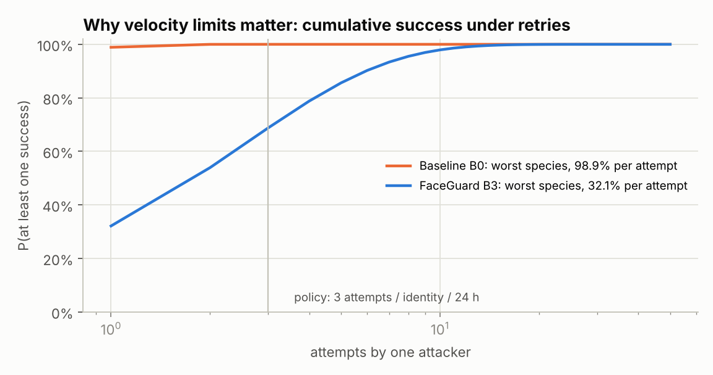

# Deliverable 2 — Adversarial Test Report
## Deepfake, face-swap, injection and presentation attacks: pass/fail rates

| | |
|---|---|
| **Systems under test** | B0 vendor liveness only (stand-in) · B1 + device/telemetry rules · B2 + capture-integrity model · **B3 FaceGuard (all layers)** |
| **Campaign** | 1083 bona fide sessions (361 subjects) + 3610 attack sessions, 10 attack species × 361 |
| **Subjects** | Held-out test split. No test face was used for training or threshold calibration |
| **Metrics** | ISO/IEC 30107-3 vocabulary: APCER per species, worst-species APCER, BPCER; DET, EER, BPCER@APCER; IAPMR for face swaps; 95 % Wilson intervals |
| **Policy** | `cal-20261014-val1083`, calibrated on the validation split's bona fide sessions only |
| **Generated** | 2026-10-14T08:23:14+00:00 from `reports/results.json` (`make eval report`) |

### Headline

| | Baseline B0 | FaceGuard B3 |
|---|---|---|
| Mean APCER across 10 attack species | 87.8% | **6.4%** |
| Worst species | 98.9% (Challenge-aware face swap (white-box)) | **32.1%** (Challenge-aware replay (white-box)) |
| Bona fide rejected (BPCER) | 1.75% | **2.40%** |
| Bona fide sent to step-up / manual review | 0.0% / 0.0% | 4.0% / 0.5% |
| Logic attacks blocked (API tests) | – | **11/11** |

---

## 1. Test setup

### 1.1 System under test

* **Vendor stand-in (B0).** No FaceTec licence is used in this portfolio project. The vendor is
  modelled by a frame-level PAD model (colour-texture + spectrum, trained on print/replay), the way
  a presentation-attack-only liveness check behaves. Its threshold is set at 1 % BPCER on
  validation. **FaceTec's 3D liveness is expected to be much stronger than this stand-in on
  print/replay** (it is iBeta-tested). The B0 rows that matter here are the **injection** rows, where
  the camera is bypassed and any camera-side PAD sees a clean, genuine-looking face.
* **FaceGuard (B1–B3)** adds its layers *on top of* the vendor decision, through the same
  `fusion.decide()` function the API calls. The evaluated policy is the deployed policy.

### 1.2 Bona fide corpus

1,994 public face photos (two MIT-licensed GitHub repositories) were processed: YuNet detection →
128 × 128 context crop + 5 landmarks → near-duplicate removal (64-bit dHash, Hamming ≤ 4, 173 removed) → 1,803
faces → deterministic 60/20/20 split. Each bona fide *session* is simulated through the full capture
chain: the screen's challenge light reflected by the face (more than by the background), head motion,
one of two camera ISP profiles (noisy, or denoised), JPEG, natural frame jitter with 4 % dropped
frames, and realistic telemetry. 3 % of honest web users run benign virtual cameras (NVIDIA Broadcast,
mmhmm), 1 % have webcams that ignore the requested resolution, and 3 % of mobile devices have no
attestation token. These are *not* idealised users.

### 1.3 Attack catalogue (PAI species / injection instruments)

| Species | Family | Instrument (PAI / IAI) | Delivery (method) | Seen in training | Attack potential |
|---|---|---|---|---|---|
| Print photo | presentation | Printed photo of victim | Held in front of a real camera | yes | low |
| Screen replay | presentation | Photo/video of victim on a phone or monitor | Held in front of a real camera | yes | low |
| Virtual cam · pre-recorded | injection | Pre-recorded genuine video of victim | Virtual camera (OBS/ManyCam), driver name visible | yes | low |
| Virtual cam · stealth | injection | Pre-recorded genuine video of victim | Virtual camera renamed to a real webcam; added sensor-like noise and timing jitter | **no** (generalisation) | moderate |
| Virtual cam · offline face swap | injection | Offline deepfake (victim face swapped onto attacker video) | Virtual camera | yes | moderate |
| Virtual cam · real-time face swap | injection | Real-time face swap (DeepFaceLive-style) of attacker's live camera | Virtual camera; label spoofed in 50% of attempts | **no** (generalisation) | high |
| Virtual cam · synthetic (GAN) | injection | Fully synthetic face (GAN-style upsampling artefacts) | Virtual camera; label spoofed in 50% of attempts | **no** (generalisation) | moderate |
| Emulator / hooked device | injection | Pre-recorded genuine video of victim | Android emulator / rooted device with camera hook (VCAM-style module) | yes | moderate |
| Challenge-aware replay (white-box) | adaptive | Pre-recorded genuine video of victim, re-lit in real time | Stealth virtual camera + screen capture of the challenge, 2-5 frame pipeline lag | **no** (generalisation) | high |
| Challenge-aware face swap (white-box) | adaptive | Real-time face swap of a live attacker, re-lit in real time | Stealth virtual camera + screen capture of the challenge, 2-5 frame pipeline lag | **no** (generalisation) | high |

Physical 3D masks (AV-03), document attacks (AV-15) and coerced users (AV-19) cannot be meaningfully
simulated in software and are excluded. They need iBeta-style lab testing and process controls.

### 1.4 Protocol

1. `src.evaluation.harness` generates seeded sessions per split: 30 frames at 30 fps, a fresh
   10-slot colour challenge per session, telemetry and timestamps.
2. The models are trained on the *train* split (deepfake models: bona fide + SBI only).
3. `src.evaluation.run_eval` scores *val* and *test*, calibrates every threshold on val bona fide
   quantiles, then evaluates on test.
4. An attack **passes** if the decision is `APPROVE`. `STEP_UP`, `MANUAL_REVIEW` and `REJECT` all
   stop it.

---

## 2. Results — attack pass rates (APCER)

| Attack species | B0 vendor only | B1 + device rules | B2 + capture integrity | **B3 FaceGuard** | 95% CI (B3) | Verdict (B3) |
|---|---|---|---|---|---|---|
| Print photo | 35.7% | 34.3% | 6.9% | **6.9%** | 4.7%–10.0% | ⚠️ PARTIAL |
| Screen replay | 76.7% | 72.9% | 9.4% | **9.4%** | 6.8%–12.9% | ⚠️ PARTIAL |
| Virtual cam · pre-recorded | 98.1% | 0.0% | 0.0% | **0.0%** | 0.0%–1.1% | ✅ PASS |
| Virtual cam · stealth † | 94.7% | 92.8% | 0.0% | **0.0%** | 0.0%–1.1% | ✅ PASS |
| Virtual cam · offline face swap | 95.6% | 0.0% | 0.0% | **0.0%** | 0.0%–1.1% | ✅ PASS |
| Virtual cam · real-time face swap † | 97.2% | 45.7% | 1.9% | **0.8%** | 0.3%–2.4% | ✅ PASS |
| Virtual cam · synthetic (GAN) † | 88.4% | 42.4% | 0.0% | **0.0%** | 0.0%–1.1% | ✅ PASS |
| Emulator / hooked device | 97.0% | 5.5% | 0.0% | **0.0%** | 0.0%–1.1% | ✅ PASS |
| Challenge-aware replay (white-box) † | 95.3% | 93.9% | 32.1% | **32.1%** | 27.5%–37.1% | ❌ FAIL |
| Challenge-aware face swap (white-box) † | 98.9% | 97.8% | 31.6% | **14.7%** | 11.4%–18.7% | ❌ FAIL |
| **Mean / worst** | 87.8% / 98.9% | 48.5% / 97.8% | 8.2% / 32.1% | **6.4% / 32.1%** | | |

† not seen in training by any model. Verdict on B3: ✅ PASS ≤ 2 % · ⚠️ PARTIAL ≤ 10 % · ❌ FAIL > 10 %.
95 % Wilson intervals: with 361 attempts per species, "0 %" means "below ~1 %", not "never".


### 2.1 Decision distribution under FaceGuard (B3)

| Attack species | Approve (APCER) | Step-up | Manual review | Reject |
|---|---|---|---|---|
| Print photo | 6.9% | 13.3% | 0.3% | 79.5% |
| Screen replay | 9.4% | 18.6% | 0.0% | 72.0% |
| Virtual cam · pre-recorded | 0.0% | 0.0% | 0.0% | 100.0% |
| Virtual cam · stealth | 0.0% | 0.0% | 0.0% | 100.0% |
| Virtual cam · offline face swap | 0.0% | 0.0% | 0.0% | 100.0% |
| Virtual cam · real-time face swap | 0.8% | 10.0% | 2.2% | 87.0% |
| Virtual cam · synthetic (GAN) | 0.0% | 0.0% | 0.0% | 100.0% |
| Emulator / hooked device | 0.0% | 0.0% | 0.0% | 100.0% |
| Challenge-aware replay (white-box) | 32.1% | 61.2% | 0.0% | 6.6% |
| Challenge-aware face swap (white-box) | 14.7% | 27.4% | 8.6% | 49.3% |


### 2.2 Red-team iteration: a finding and its fix

The first run exposed a gap. The capture-integrity model had only been trained on species *without*
a delayed reflection, so real-time swaps and the challenge-aware attacker (whose reflection arrives
3–10 frames late) often scored below its review threshold, and the explicit lag check existed only
as an explanation string. The fix promotes that physical check to a decision rule:
`CHALLENGE_REFLECTION_DELAYED` (soft → step-up) fires when the reflection peaks after the camera
window and correlates ≥ 0.4, more than 0.15 above the in-window peak. Both constants were sized on
the **validation** split (0 % of bona fide sessions trigger it). Both policies on the final campaign:

| B3 FaceGuard, same test campaign | Run 1 policy (capture-integrity model only) | Run 2 policy (+ delayed-reflection rule) |
|---|---|---|
| APCER · Challenge-aware replay (white-box) | 90.9% | **32.1%** |
| APCER · Challenge-aware face swap (white-box) | 39.9% | **14.7%** |
| APCER · Virtual cam · real-time face swap | 8.9% | **0.8%** |
| Mean APCER (10 species) | 15.6% | **6.4%** |
| Worst-species APCER | 90.9% | **32.1%** |
| Bona fide rejected / friction | 2.40% / 6.8% | 2.40% / 6.8% |

What remains is the challenge-aware attacker whose pipeline lag falls *inside* the honest camera
window (2 frames ≈ 67 ms). In this simulation that attacker is physically indistinguishable from a live
user. It is the documented residual risk, closed by native capture with attestation (Deliverable 4).
For the **face-swap** variant of that attacker, the deepfake layer is the last barrier: it cuts the
pass rate from 31.6% (B2) to 14.7% (B3). This is the clearest
measured case for keeping a manipulation detector *behind* the challenge.
*Disclosure: the gap was found on an earlier test run. The rule's constants never saw test data, and
the final campaign was regenerated afterwards, with a new white-box species added (challenge-aware face swap).*

---

## 3. Bona fide impact (BPCER and friction)

| Variant | Approved | Step-up | Manual review | Rejected (BPCER) | Friction (not auto-approved) |
|---|---|---|---|---|---|
| B0 — Vendor liveness only (PAD stand-in) | 98.2% | 0.0% | 0.0% | 1.8% [1.1%–2.7%] | 1.8% |
| B1 — + device / telemetry integrity rules | 95.6% | 2.7% | 0.0% | 1.8% [1.1%–2.7%] | 4.4% |
| B2 — + capture-integrity model (nonce challenge, timing, sensor noise) | 94.0% | 4.0% | 0.0% | 2.0% [1.3%–3.1%] | 6.0% |
| B3 — + deepfake detector = FaceGuard full | 93.2% | 4.0% | 0.5% | 2.4% [1.6%–3.5%] | 6.8% |

Friction is the price of defence. Most of it comes from *soft* findings on honest users (benign
virtual cameras, missing attestation, resolution mismatches) and from review bands. Those users are
**stepped up** (retry in the native app, NFC document read), not rejected.

---

## 4. Per-layer analysis

| Layer | Evaluated against | AUC | EER | BPCER @ APCER 5% | BPCER @ APCER 1% |
|---|---|---|---|---|---|
| PAD texture (frame) | Print photo, Screen replay | 0.922 | 15.4% | 41.6% | 61.5% |
| Capture integrity (session) | all 10 species | 0.955 | 8.7% | 34.5% | 85.6% |
| **Deepfake layer** (mean of the two below) | Virtual cam · offline face swap, Virtual cam · real-time face swap, Challenge-aware face swap (white-box) | 0.949 | 11.7% | 28.3% | 48.5% |
| ↳ CNN (PyTorch → ONNX) | Virtual cam · offline face swap, Virtual cam · real-time face swap, Challenge-aware face swap (white-box) | 0.955 | 11.2% | 27.1% | 51.1% |
| ↳ Forensics GBM | Virtual cam · offline face swap, Virtual cam · real-time face swap, Challenge-aware face swap (white-box) | 0.901 | 19.4% | 42.0% | 55.9% |

Per-species separability (AUC, bona fide vs. that species):

| Attack species | PAD AUC | Capture-integrity AUC | Deepfake AUC (CNN / forensics) |
|---|---|---|---|
| Print photo | 0.965 | 0.988 | 0.554 (0.577 / 0.525) |
| Screen replay | 0.879 | 0.994 | 0.485 (0.467 / 0.489) |
| Virtual cam · pre-recorded | 0.590 | 1.000 | 0.781 (0.722 / 0.793) |
| Virtual cam · stealth † | 0.686 | 1.000 | 0.338 (0.324 / 0.360) |
| Virtual cam · offline face swap | 0.758 | 1.000 | 0.927 (0.923 / 0.887) |
| Virtual cam · real-time face swap † | 0.639 | 0.979 | 0.961 (0.970 / 0.909) |
| Virtual cam · synthetic (GAN) † | 0.777 | 1.000 | 0.570 (0.543 / 0.558) |
| Emulator / hooked device | 0.580 | 1.000 | 0.786 (0.730 / 0.792) |
| Challenge-aware replay (white-box) † | 0.635 | 0.790 | 0.325 (0.309 / 0.353) |
| Challenge-aware face swap (white-box) † | 0.627 | 0.795 | 0.961 (0.971 / 0.906) |


Reading the layers together:

* **PAD texture** separates print better than screen replay. Single-frame texture is the weakest
  layer and is not designed to see injections.
* **Capture integrity** separates almost every species, because the nonce challenge cannot be
  pre-recorded. Its weakest species is the white-box *challenge-aware* attacker, by design.
* **Deepfake (CNN + forensics)** is trained without any deepfake. It separates face-swap species it
  never saw, but not fully synthetic GAN-style faces: whole-frame synthesis has no blending seam and
  no camera/generated noise mismatch. The capture-integrity layer covers that species instead.
  This is why the layers are fused.

### 4.1 Face matching does not stop face swaps (IAPMR)

SFace 1:1 matching (OpenCV Zoo, cosine threshold 0.363) was run between a frame of each face-swap
attack and the **victim's** reference photo:

| Species | n | IAPMR (matcher accepts the attack as the victim) | Matches the attacker instead |
|---|---|---|---|
| Virtual cam · offline face swap | 359 | 89.7% [86.1%–92.4%] | 6.1% |
| Virtual cam · real-time face swap | 360 | 91.1% [87.7%–93.6%] | 4.4% |

Zero-effort impostor acceptance for context: 2.0% [1.0%–4.0%] (n = 357). The reference here is
the victim's source photo, so this is an **upper bound**: with an independent ID-document portrait,
IAPMR is lower. The conclusion still stands: **once a swap reaches the matcher, identity checks help
the attacker**, so liveness and deepfake detection must sit in front of matching.

---

## 5. Logic and integration attacks (automated, `pytest`)

| Logic attack (vulnerability) | Automated test | Result |
|---|---|---|
| AV-12 API replay of a captured submission | `test_session_replay_is_refused` | ✅ blocked |
| Forged / guessed session token | `test_forged_session_token_is_refused` | ✅ blocked |
| AV-10 Client-side verdict tampering (`livenessPassed: true`) + virtual camera | `test_virtual_camera_injection_rejected_even_with_client_claims` | ✅ blocked |
| AV-11 Only `success` checked — replay check failing | `test_facetec_success_flag_alone_is_not_enough` | ✅ blocked |
| AV-11 Vendor response missing security checks | `test_facetec_missing_checks_fail_closed` | ✅ blocked |
| Vendor outage must not approve (fail closed) | `test_facetec_outage_fails_closed` | ✅ blocked |
| Vendor session token reuse / payload replay | `test_simulated_vendor_enforces_one_time_token_and_replay` | ✅ blocked |
| AV-13 Probing: >3 attempts per identity / 24 h | `test_identity_velocity_limit` | ✅ blocked |
| AV-16 Account farming: one device, many identities | `test_device_used_by_many_identities_is_blocked` | ✅ blocked |
| AV-04 Stealth injection (renamed driver) caught by the nonce challenge | `test_stealth_injection_caught_by_challenge` | ✅ blocked |
| Malformed capture (frame count ≠ challenge) | `test_wrong_frame_count_is_422` | ✅ blocked |

These are the integration flaws from the vulnerability assessment (AV-10…AV-16). They need no ML,
and they run in CI on every commit.

---

## 6. Retry / probing risk

With per-attempt success *p*, the chance an attacker succeeds at least once in *n* tries is
1 − (1 − p)ⁿ. Using the worst species' per-attempt APCER:

| Attempts | B0 (p = 98.9%) | FaceGuard B3 (p = 32.1%, Challenge-aware replay (white-box)) |
|---|---|---|
| 3 (policy limit / identity / 24 h) | 100.0% | 68.7% |
| 10 | 100.0% | 97.9% |
| 50 (no velocity limit) | 100.0% | 100.0% |

Velocity limits cap the damage of moderate species (a 0.6 % per-attempt real-time swap stays at
~2 % after 3 tries), but they cannot fix a species with a high per-attempt rate. The white-box
residual is closed by channel controls (native capture + attestation), not by counting attempts.



---

## 7. Limitations and threats to validity

* **Simulated instruments.** Print, replay, codecs, virtual-camera timing, emulator telemetry,
  face swaps and GAN artefacts are software models of real tooling. They exercise every code path
  and give reproducible, comparable numbers, but **absolute rates will differ on real attacks**.
  The same harness accepts real captured media. For a client this campaign would be re-run with
  OBS / DeepFaceLive / rooted-device captures recorded under written authorisation.
* **Vendor stand-in.** B0 is not FaceTec. Read improvements on injection rows as "beyond what
  any camera-side PAD can see", not as "better than FaceTec".
* **Same simulator for training and test** on seen species. Unseen species (†), held-out subjects
  and calibration without attack data are the safeguards. Seen-species results are optimistic.
* **Population.** Bona fide faces are internet photos (varied ethnicity, age and quality), not a
  controlled demographic sample. Per-demographic BPCER should be measured on client traffic.
* **Sample size.** 361 attacks per species gives ±~1–5 pp intervals. Rare-event
  claims (< 1 %) need larger campaigns.

---

## 8. Reproduce

```bash
make assets data sessions train eval report   # ~1.5 h on 2 CPU cores, no GPU
pytest -q --junitxml reports/junit.xml        # logic-attack table
```
