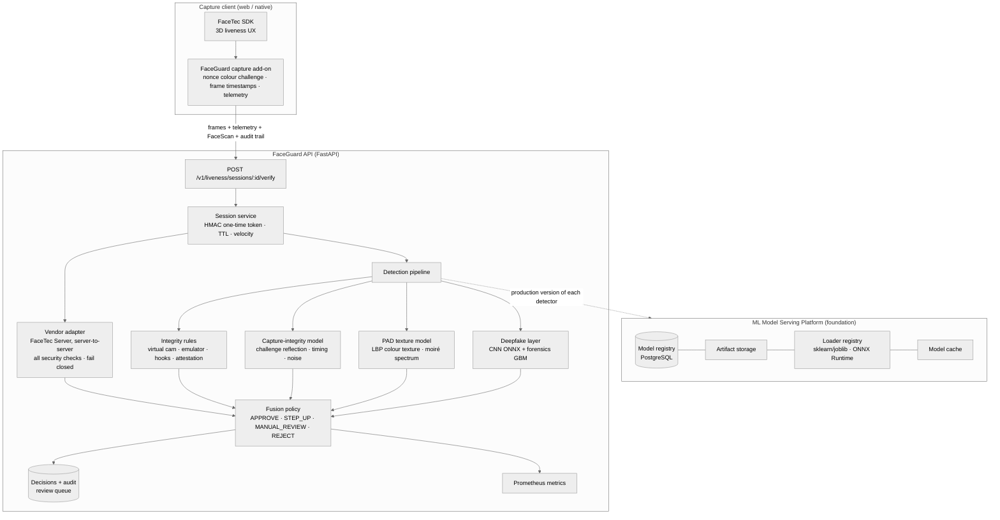
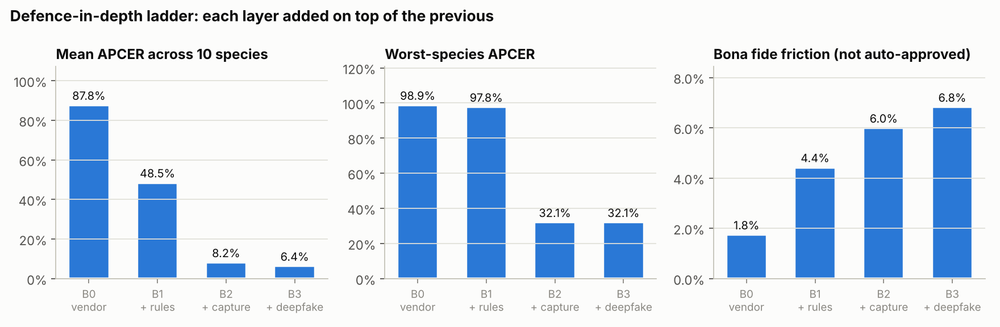
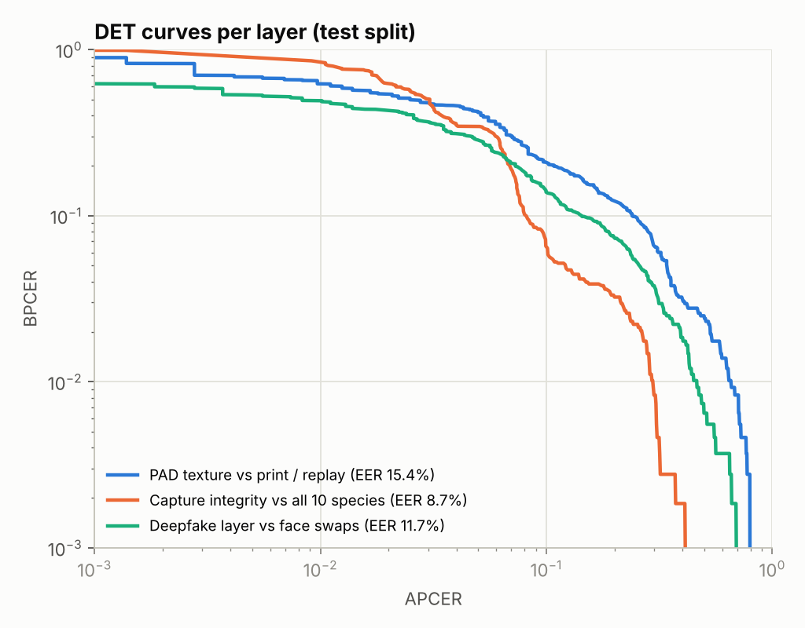
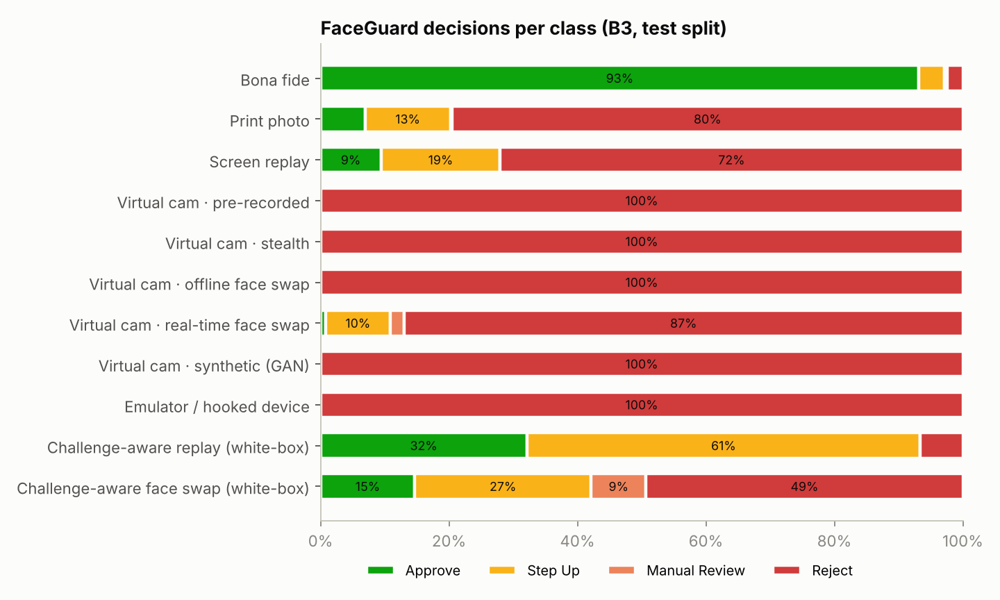

# Deliverable 3 — Mitigation Layer: design, implementation and measured improvement

FaceGuard is an **additional defence layer around the FaceTec flow**. It does not replace it. It runs
on the [ML Model Serving Platform](../README.md#built-on-the-ml-model-serving-platform): every
detector is a versioned, registry-managed model, so it can be promoted, rolled back and monitored
like any other production model.

> All numbers below are rendered from `reports/results.json` (policy `cal-20261014-val1083`,
> generated 2026-10-14T08:23:14+00:00). Test campaign: 1083 bona fide sessions from 361 held-out
> subjects, plus 3610 attack sessions (361 per species). How the campaign was
> built and its limitations: [Deliverable 2](02-adversarial-test-report.md).

---

## 1. Architecture

| Component | Code | What it does |
|---|---|---|
| Session service | `src/liveness/sessions.py` | Issues a **nonce-bound colour challenge** and a one-time HMAC token (TTL 120 s). Consumption is atomic (`UPDATE … WHERE status='issued'`). Velocity limits per identity, device and identities-per-device |
| Vendor adapter | `src/liveness/providers/facetec.py` | Server-to-server FaceTec call. Requires **every** `faceScanSecurityChecks` flag, ignores client claims, fails closed, never logs the result blob |
| Integrity rules | `src/liveness/signals/capture_integrity.py` | Deterministic reason codes: `VIRTUAL_CAMERA`, `BROWSER_AUTOMATION`, `EMULATOR`, `HOOKING_FRAMEWORK`, `ATTESTATION_FAILED` (hard); `VIRTUAL_CAMERA_BENIGN`, `ATTESTATION_MISSING`, `SENSORS_MISSING`, `RESOLUTION_MISMATCH`, `CHALLENGE_REFLECTION_DELAYED` (soft) |
| Capture-integrity model | same file + `train_tabular.py` | 12 stream features → HistGradientBoosting. Features: challenge correlation at camera-latency lags vs. later lags, face/background reflection ratio, frame-interval jitter, duplicated frames, sensor-noise floor, effective resolution |
| PAD texture model | `src/liveness/signals/texture.py` | 384 features: uniform LBP on Y/Cr/Cb/H/S/V, radial log-spectrum + moiré peak, gamut/dynamic-range/glare statistics |
| Deepfake layer | `src/training/deepfake_net.py`, `src/liveness/signals/artifacts.py` | **Mean of two views**: a compact CNN (PyTorch → ONNX, fixed high-pass input branch) and a forensics GBM (inside/outside-face noise, sharpness, seam gradient/colour jump, up-sampling spectral peaks) |
| Fusion | `src/liveness/fusion.py` | Most severe outcome wins. Each layer has a *review* and a *reject* threshold calibrated from bona fide quantiles |
| MSP extensions | `src/serving/loader.py`, `service.py` | Loader registry (`scikit-learn/joblib`, `onnx/onnx`, `pytorch/onnx`), `ModelRuntime.get_production_model`, SQLite support for CI |

### 1.1 The nonce-bound photometric challenge (the core anti-injection idea)

The server derives a 10-slot colour sequence from a fresh 128-bit nonce (HMAC-SHA256 keystream,
no immediate repeats). During capture the client turns the screen into a light source, showing each
colour for 100 ms while it records frames. FaceGuard then computes, for lags of 0–12 frames, the
correlation between the challenge and the **face-minus-background** colour response:

* A **live face** is closer to the screen than the background, so it reflects more, at camera
  latency (≤ 2 frames).
* A **printed photo or screen** reflects uniformly or not at all (flat artefact). The face/background
  differential stays near zero, even though the raw face colour does follow the challenge.
* A **pre-recorded or offline-generated stream** cannot contain a sequence that did not exist
  when it was made.
* A **real-time face swap** does carry the reflection (the attacker sits in front of a real
  screen), but **late**: the swap pipeline adds 4–10 frames of latency.

Security comes from the **unpredictability of the nonce**, not from a learned model, so this layer
generalises to injection tools it has never seen. Its known limit is the *challenge-aware*
white-box attacker (AV-09), measured in [Deliverable 2](02-adversarial-test-report.md).

### 1.2 Deepfake layer: trained without a single deepfake

Both deepfake models are trained only on bona fide faces and **Self-Blended Images** (SBI; Shiohara
& Yamasaki, CVPR 2022), made in an *injection-faithful* way: a real camera frame (sensor noise, ISP,
challenge tint) has a generated, re-coloured, resampled copy of the *same* face blended in, and is
delivered without a second camera pass. No face swap, GAN face or real-time swap is ever shown during
training. Those species are pure generalisation tests.

An earlier iteration applied the camera model *after* blending (as if the fake were re-captured).
Val AUC on SBI stalled at about 0.6 and the network memorised the ~1k real training faces. Modelling
the actual delivery path, plus geometric/colour jitter of the base image, fixed it. This design
decision is recorded here because it is the difference between a detector that works and one that
does not.

### 1.3 Red-team iteration (finding → fix → re-test)

Red-team run 1 showed that real-time swaps and challenge-aware attackers got through more often than
expected. The capture-integrity *model* had never seen a delayed reflection, and the lag check was only
an explanation. Promoting the physical check to a deterministic rule (`CHALLENGE_REFLECTION_DELAYED`
→ step-up, sized on validation with 0 % bona fide hits) gave, on the same final test campaign:

| B3 FaceGuard, same test campaign | Run 1 policy (capture-integrity model only) | Run 2 policy (+ delayed-reflection rule) |
|---|---|---|
| APCER · Challenge-aware replay (white-box) | 90.9% | **32.1%** |
| APCER · Challenge-aware face swap (white-box) | 39.9% | **14.7%** |
| APCER · Virtual cam · real-time face swap | 8.9% | **0.8%** |
| Mean APCER (10 species) | 15.6% | **6.4%** |
| Worst-species APCER | 90.9% | **32.1%** |
| Bona fide rejected / friction | 2.40% / 6.8% | 2.40% / 6.8% |

---

## 2. Calibrated thresholds (policy `cal-20261014-val1083`)

Thresholds are set on the **validation split's bona fide sessions only** (attack data is never used
to pick them). Each layer gets a BPCER budget, which bounds honest-user friction by construction:

| Layer | Review threshold (→ action) | Reject threshold | Bona fide budget (val) |
|---|---|---|---|
| Vendor stand-in (PAD) | – | 0.9477 | 1.0 % |
| PAD texture (second opinion) | 0.9477 (→ manual review) | 0.9704 | 0.5 % reject |
| Capture integrity | 0.9119 (→ step-up) | 0.9874 | 2.0 % review · 0.5 % reject |
| Deepfake (CNN + forensics) | 0.8427 (→ manual review) | 0.9090 | 1.5 % review · 0.5 % reject |

Full policy: `configs/policy.yaml`, served at `GET /v1/liveness/policy`.

---

## 3. Measured improvement (held-out test split)

### 3.1 Defence-in-depth ladder

| | B0 vendor only | B1 + device rules | B2 + capture integrity | **B3 FaceGuard** |
|---|---|---|---|---|
| Mean APCER (10 species) | 87.8% | 48.5% | 8.2% | **6.4%** |
| Worst-species APCER | 98.9% | 97.8% | 32.1% | **32.1%** |
| Bona fide rejected (BPCER) | 1.75% | 1.75% | 2.03% | **2.40%** |
| Bona fide friction (step-up + review + reject) | 1.8% | 4.4% | 6.0% | **6.8%** |

### 3.2 Per attack species (APCER = share auto-approved)

| Attack species | B0 vendor only | B1 + device rules | B2 + capture integrity | **B3 FaceGuard** | 95% CI (B3) | Verdict (B3) |
|---|---|---|---|---|---|---|
| Print photo | 35.7% | 34.3% | 6.9% | **6.9%** | 4.7%–10.0% | ⚠️ PARTIAL |
| Screen replay | 76.7% | 72.9% | 9.4% | **9.4%** | 6.8%–12.9% | ⚠️ PARTIAL |
| Virtual cam · pre-recorded | 98.1% | 0.0% | 0.0% | **0.0%** | 0.0%–1.1% | ✅ PASS |
| Virtual cam · stealth † | 94.7% | 92.8% | 0.0% | **0.0%** | 0.0%–1.1% | ✅ PASS |
| Virtual cam · offline face swap | 95.6% | 0.0% | 0.0% | **0.0%** | 0.0%–1.1% | ✅ PASS |
| Virtual cam · real-time face swap † | 97.2% | 45.7% | 1.9% | **0.8%** | 0.3%–2.4% | ✅ PASS |
| Virtual cam · synthetic (GAN) † | 88.4% | 42.4% | 0.0% | **0.0%** | 0.0%–1.1% | ✅ PASS |
| Emulator / hooked device | 97.0% | 5.5% | 0.0% | **0.0%** | 0.0%–1.1% | ✅ PASS |
| Challenge-aware replay (white-box) † | 95.3% | 93.9% | 32.1% | **32.1%** | 27.5%–37.1% | ❌ FAIL |
| Challenge-aware face swap (white-box) † | 98.9% | 97.8% | 31.6% | **14.7%** | 11.4%–18.7% | ❌ FAIL |
| **Mean / worst** | 87.8% / 98.9% | 48.5% / 97.8% | 8.2% / 32.1% | **6.4% / 32.1%** | | |

† not seen by any model during training (generalisation test). Verdict: ✅ ≤ 2 %, ⚠️ ≤ 10 %, ❌ > 10 %.

### 3.3 What each layer contributes on its own

| Layer | Evaluated against | AUC | EER | BPCER @ APCER 5% | BPCER @ APCER 1% |
|---|---|---|---|---|---|
| PAD texture (frame) | Print photo, Screen replay | 0.922 | 15.4% | 41.6% | 61.5% |
| Capture integrity (session) | all 10 species | 0.955 | 8.7% | 34.5% | 85.6% |
| **Deepfake layer** (mean of the two below) | Virtual cam · offline face swap, Virtual cam · real-time face swap, Challenge-aware face swap (white-box) | 0.949 | 11.7% | 28.3% | 48.5% |
| ↳ CNN (PyTorch → ONNX) | Virtual cam · offline face swap, Virtual cam · real-time face swap, Challenge-aware face swap (white-box) | 0.955 | 11.2% | 27.1% | 51.1% |
| ↳ Forensics GBM | Virtual cam · offline face swap, Virtual cam · real-time face swap, Challenge-aware face swap (white-box) | 0.901 | 19.4% | 42.0% | 55.9% |

### 3.4 Where FaceGuard sends each case

| Attack species | Approve (APCER) | Step-up | Manual review | Reject |
|---|---|---|---|---|
| Print photo | 6.9% | 13.3% | 0.3% | 79.5% |
| Screen replay | 9.4% | 18.6% | 0.0% | 72.0% |
| Virtual cam · pre-recorded | 0.0% | 0.0% | 0.0% | 100.0% |
| Virtual cam · stealth | 0.0% | 0.0% | 0.0% | 100.0% |
| Virtual cam · offline face swap | 0.0% | 0.0% | 0.0% | 100.0% |
| Virtual cam · real-time face swap | 0.8% | 10.0% | 2.2% | 87.0% |
| Virtual cam · synthetic (GAN) | 0.0% | 0.0% | 0.0% | 100.0% |
| Emulator / hooked device | 0.0% | 0.0% | 0.0% | 100.0% |
| Challenge-aware replay (white-box) | 32.1% | 61.2% | 0.0% | 6.6% |
| Challenge-aware face swap (white-box) | 14.7% | 27.4% | 8.6% | 49.3% |

---

## 4. Operating characteristics

* **Latency:** a 30-frame 640×480 session (face detection, 4 models, fusion) takes 162 ms
  p50 / 211 ms p95 of server time on a 2-vCPU container with a warm model cache
  (`scripts/bench_latency.py`). It is exported as `faceguard_pipeline_latency_seconds`, with an alert
  at p95 > 1.5 s.
* **Serving footprint:** no PyTorch in the serving image. The CNN runs on ONNX Runtime (0.67 M params).
* **Lifecycle:** each detector is an MSP model (`faceguard-pad-texture`, `faceguard-capture-integrity`,
  `faceguard-deepfake`, `faceguard-deepfake-forensics`). `POST /models/{name}/versions/{v}/promote`
  switches the version the pipeline uses on the next request (covered by an automated test). Promotion
  re-loads the artifact and refuses corrupt files, which is MSP behaviour.
* **Explainability:** every decision stores per-layer scores, bands, reason codes, model versions and
  policy version. Reviewers see `CHALLENGE_REFLECTION_DELAYED`, `VIRTUAL_CAMERA (OBS Virtual Camera)`,
  `cnn=0.93 forensics=0.71`, not just a number.

---

## 5. Residual risk after mitigation

* **Challenge-aware white-box injection (AV-09)** remains the hardest case. In the harness,
  32.1% of re-lit replays and 14.7% of re-lit face swaps are auto-approved:
  those whose pipeline lag falls inside the honest camera window. The deepfake layer is what holds the
  face-swap variant (31.6% → 14.7%). Closing the rest needs **native capture with platform
  attestation** for high-risk actions, randomised challenge timing, and a physically richer challenge
  check (specular highlights on the eyes, geometry-consistent shading). See
  [Deliverable 4](04-recommendations.md).
* **Fully synthetic faces** are caught by the capture-integrity layer, not the deepfake layer:
  SBI-style training does not generalise to whole-frame synthesis (deepfake-layer AUC on that species
  is reported in Deliverable 2). If synthetic-identity onboarding is in scope, add a dedicated
  synthetic-image detector trained on current generators.
* Absolute rates come from a software-simulated campaign. Re-measuring on the client's own traffic
  and on real tooling is part of the engagement plan (Deliverable 4 §5).
